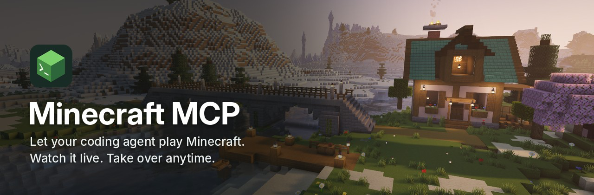
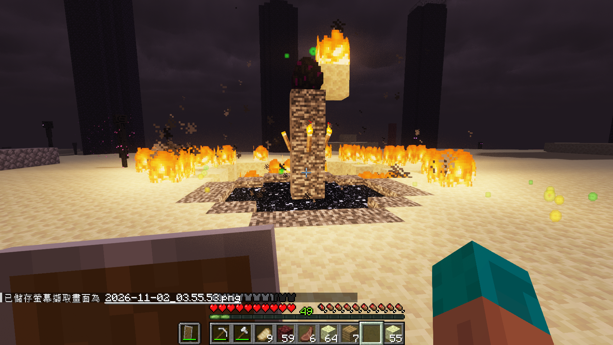
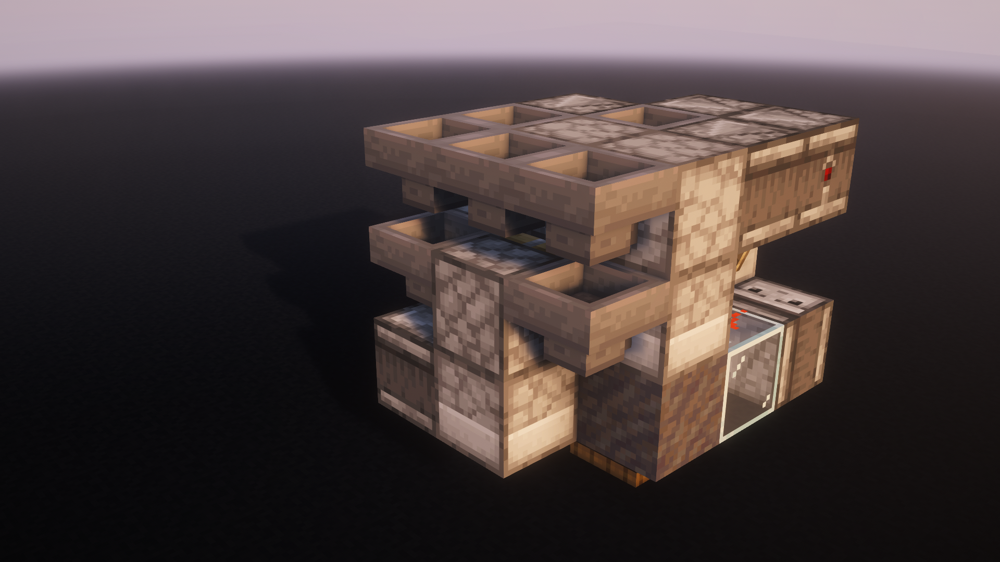

<p align="center">
  
</p>
<h1 align="center">Minecraft MCP</h1>
<p align="center">Let an AI agent play in your Minecraft client. Take over with <code>/mcp stop</code>.</p>
<p align="center">
  <a href="https://www.npmjs.com/package/@makkch/minecraft-mcp"></a>
  <a href="LICENSE"></a>
  <a href="https://github.com/MakkCH/minecraft_mcp/releases"></a>
  <a href="#remote-connection"></a>
</p>
<p align="center">
  <a href="README.md">English</a> · <a href="README.zh-Hant.md">繁體中文</a><br />
  <a href="#gallery">Gallery</a> · <a href="#requirements">Requirements</a> · <a href="#installation">Installation</a> · <a href="#staying-in-control">Staying in control</a> · <a href="#remote-connection">Remote connection</a>
</p>

The agent controls your character with JsMacros scripts: it writes one, runs it, reads the output, takes a screenshot, and reports in chat. You watch from your own point of view and type `/mcp stop` whenever you want the controls back.

## Gallery

Everything here was done by an agent through Minecraft MCP. [Browse all projects](assets/projects/README.md).

<table>
  <tr>
    <td width="50%" valign="top">
      <a href="assets/projects/end-poem/README.md"></a>
      <h3>From an empty inventory to the End Poem</h3>
      <p>A Codex agent (<code>gpt-6-astra</code>, <code>high</code> reasoning effort) started with nothing, gathered resources, reached the End and defeated the Ender Dragon. It wrote and revised its own JavaScript along the way: mining, trading, recovering gear after deaths, building safer routes, and finally setting off beds from behind a wall.</p>
      <p>Java 26.3, Normal difficulty, about 8 hours 25 minutes. <a href="assets/projects/end-poem/README.md">Full run and retrospective</a></p>
    </td>
    <td width="50%" valign="top">
      <a href="assets/projects/f36/README.md"></a>
      <h3>F36: a compact 6× shulker box loader</h3>
      <p>A 3×3×4 single-item shulker box loader designed by GPT-6 Astra. Modules with minecarts tile every three blocks at the same height; a single module runs without one.</p>
      <p>Schematics exported from Java 26.3. <a href="https://www.bilibili.com/video/BV1JBW76CEM5/">Watch the video</a> · <a href="assets/projects/f36/README.md">Download the schematics</a></p>
    </td>
  </tr>
</table>

The banner scene was built and captured in Minecraft by GPT-6 Astra using Minecraft MCP.

## Requirements

Fabric only for now. Forge, NeoForge and other Minecraft versions are not supported yet.

| Minecraft Java Edition | Download this JAR group | Baritone API Fabric (optional) |
| --- | --- | --- |
| 26.1, 26.1.1, 26.1.2 | 26.1 | 1.18.0 |
| 26.2 | 26.2 | 1.19.0 |
| 26.3 | 26.3 | 1.20.0 |

| Component | Requirement |
| --- | --- |
| Fabric Loader | 0.19.5 or later |
| Java | 25 or later |
| JsMacros Reloaded | 2.2.1, same JAR group as above (bundles the Fabric API modules this mod needs) |
| Node.js | 22+ for the MCP server; 22.20+ for [Skills CLI](https://github.com/vercel-labs/skills) |
| Agent | Codex, Claude Code, Claude Desktop, Cursor, or any client with stdio MCP support |
| Baritone | Optional, strongly recommended |

Without Baritone, scripts, screenshots and direct player control still work, but the agent has to script its own pathfinding and resource gathering.

## Installation

There are three things to install:

| | Where | What it does |
| --- | --- | --- |
| **Mod** | Minecraft | Receives commands and runs them in the game |
| **Skill** | Agent | Teaches the agent how to write scripts and which APIs exist |
| **MCP server** | Agent | Exposes the game as tools the agent can call |

We recommend running the agent, MCP server and Minecraft on the same computer.

### 1. Install the mod

1. Download the mod JAR for your Minecraft version from [GitHub Releases](https://github.com/MakkCH/minecraft_mcp/releases) (not the `-sources.jar`).
2. Put it in your game's `mods/` folder together with JsMacros and, preferably, Baritone.
3. Launch the game and press **F8** to open the settings screen.
4. Copy the **token** and note the **port** (normally `28473`). You need both in step 3.

`/mcp config` opens the same screen. So does Mods → Minecraft MCP → Configure if you have [Mod Menu](https://modrinth.com/mod/modmenu). F8 can be rebound in Minecraft's Controls settings.

The screen also has: Allow remote (off by default), automatic startup, and the `[AGENT]` chat tag, name and colors. Pressing Apply stops any running agent tasks.

<details>
<summary>Where is my <code>mods/</code> folder?</summary>

| Launcher | Location |
| --- | --- |
| Official Minecraft Launcher | `mods/` inside the installation's Game Directory. By default `.minecraft/mods/` on Windows/Linux, `~/Library/Application Support/minecraft/mods/` on macOS |
| Prism Launcher, MultiMC | Open the instance's Minecraft folder; usually `.minecraft/mods/` inside the instance folder |
| Other launchers | Open the instance's game folder and use its `mods/` |

</details>

### 2. Install the Skill

```sh
npx skills add MakkCH/minecraft_mcp --skill minecraft-mcp -g
```

Pick your agent when prompted, or name it directly with `-a codex`, `-a claude-code` or `-a cursor`. `-g` installs for your user so every project can use it; leave it out to install for the current project only.

If your client has no Skill support, give the agent [SKILL.md](skills/minecraft-mcp/SKILL.md) as instructions and make sure it can read the files that document refers to.

### 3. Add the MCP server

Add a **stdio** MCP server in your agent client, using the token and port from step 1.

<details open>
<summary>Codex</summary>

Add this to `~/.codex/config.toml`. If a `minecraft_mcp` entry already exists, edit it instead of adding a second one. ([Codex MCP documentation](https://developers.openai.com/codex/mcp))

```toml
[mcp_servers.minecraft_mcp]
command = "npx"
args = ["-y", "@makkch/minecraft-mcp@latest"]

[mcp_servers.minecraft_mcp.env]
MINECRAFT_MCP_TOKEN = "YOUR_TOKEN"
MINECRAFT_MCP_PORT = "28473"
```

</details>

<details>
<summary>Claude Code</summary>

([MCP documentation](https://code.claude.com/docs/en/mcp))

```sh
claude mcp add --env MINECRAFT_MCP_TOKEN=YOUR_TOKEN \
  --env MINECRAFT_MCP_PORT=28473 --transport stdio --scope user minecraft_mcp \
  -- npx -y @makkch/minecraft-mcp@latest
```

</details>

<details>
<summary>Cursor / Claude Desktop</summary>

For Cursor, add this to `~/.cursor/mcp.json` or your project's `.cursor/mcp.json`. For Claude Desktop, add it to `claude_desktop_config.json`. ([Cursor documentation](https://cursor.com/docs/mcp) · [Claude Desktop guide](https://modelcontextprotocol.io/docs/develop/connect-local-servers))

```json
{
  "mcpServers": {
    "minecraft_mcp": {
      "command": "npx",
      "args": ["-y", "@makkch/minecraft-mcp@latest"],
      "env": {
        "MINECRAFT_MCP_TOKEN": "YOUR_TOKEN",
        "MINECRAFT_MCP_PORT": "28473"
      }
    }
  }
}
```

</details>

<details>
<summary>Other clients (setup form)</summary>

| Field | Value |
| --- | --- |
| Name | `minecraft_mcp` |
| Transport | `stdio` |
| Command | `npx` |
| Arguments | `-y` and `@makkch/minecraft-mcp@latest` (two separate arguments) |
| Environment | `MINECRAFT_MCP_TOKEN`, `MINECRAFT_MCP_PORT` |

</details>

Good to know:

- `npx -y @makkch/minecraft-mcp@latest` is meant to be run by your MCP client. Run it yourself in a terminal and you only get a process waiting for input.
- `@latest` selects the version tagged `latest` on npm. To pin a version, replace it with a version number that is [compatible](#versions-and-compatibility) with your mod.
- The token gives control of your game. Keep it out of shared repositories.

### 4. Try it

Restart your client's MCP connection, start a new chat, and say:

> Inspect my Minecraft client and tell me what you can see.

> Gather some wood nearby and keep me updated in chat.

If nothing happens, see [Connection help](#connection-help).

<details>
<summary>Other ways to install: release archive, Codex plugin</summary>

**Archive (`.tgz`)**: download it from the release and extract it. In your MCP configuration, set the command to `node` and the argument to the absolute path of `src/server.mjs`; the environment variables stay the same. Install the Skill as in step 2.

**Codex plugin**: still available and includes the Skill, but not recommended for new installations. Use the standalone setup above to configure the token and port for each game instance ([Codex MCP settings](https://developers.openai.com/codex/mcp#plugin-provided-mcp-servers)). See [Codex plugin installation](https://developers.openai.com/plugins/build/plugins).

If you already use the plugin and want to switch to the standalone setup above, disable the plugin before enabling the standalone MCP server and Skill.

</details>

## Staying in control

| In Minecraft | Effect |
| --- | --- |
| `/mcp stop` | Disable the agent, cancel MCP scripts, release held keys |
| `/mcp start` | Allow the agent to act again |
| `/mcp status` | Show whether control is enabled and how many tasks are running |
| `/mcp config` or F8 | Open the settings screen |

- While disabled, the agent can still take screenshots but cannot act.
- Disconnecting from a server or leaving a singleplayer world cancels running tasks. Changing dimensions does not.
- `[AGENT]` messages appear only in your own chat. They are not sent to multiplayer servers.
- The mod interface is in English.

The mod adds no blocks, items or entities, so removing it needs no changes to your save. What the agent does is as real as what you do: it changes your world and inventory.

## Remote connection

<details>
<summary>Optional: connect to a game on another computer</summary>

Script contents can be sent to another computer, but `require()` and other file access use the game computer's filesystem. Use self-contained scripts or prepare dependencies on the game computer yourself.

1. Enable **Allow remote** in the game's F8 settings and press Apply. Allow the game port through its firewall.
2. In your agent's MCP configuration, replace `MINECRAFT_MCP_PORT` with `MINECRAFT_MCP_URL`, such as `http://192.168.1.20:28473/`.
3. Use the token from the game's F8 screen, then restart the MCP connection.

Alternatively, leave Allow remote off and use an SSH tunnel:

```sh
ssh -N -L 38473:127.0.0.1:28473 user@game-host
```

Set the URL to `http://127.0.0.1:38473/`. `MINECRAFT_MCP_URL` also accepts HTTPS, IPv6, custom ports and proxy path prefixes.

Scripts run with the full permissions of the Minecraft process. Connect only trusted agents; use SSH or HTTPS across untrusted networks to protect the token and script contents. Custom addresses and Allow remote require 0.4.0 or later.

</details>

## Connection help

| Symptom | What to do |
| --- | --- |
| Connection refused | Check that you launched the instance with the mod, and compare the port with F8 |
| Authentication failed / HTTP 401 | The token does not match F8. Fix it and restart the MCP connection |
| Agent control disabled | Type `/mcp start` in the game |
| Agent cannot find the tools | Check that the MCP server is enabled and Node.js is installed, then start a new chat |
| Port already in use | When running several game instances, give each a different port in F8 |
| Incompatible Minecraft MCP versions | Update the mod and MCP server to [compatible versions](#versions-and-compatibility) |
| Remote connection refused / 404 | Check in order: Allow remote, IP and port, firewall, tunnel or proxy, URL prefix |

## Updating

| Component | How |
| --- | --- |
| Mod | Download the new JAR from [Releases](https://github.com/MakkCH/minecraft_mcp/releases), close the game, replace the old file in `mods/` |
| MCP server (npm) | With `@latest`, restart the MCP connection. If pinned, change the version number in your configuration first |
| Skill | `npx skills update minecraft-mcp -g` (use `-p` for a project-level install) |
| Archive | Replace the extracted folder and restart the MCP connection |
| Codex plugin | Update from the source you installed it from, then start a new chat |

Updating does not touch your settings in the game or in the agent client. Update the MCP server and installed Skill together. Check that the MCP server is compatible with your mod.

## Versions and compatibility

The mod and the agent package (MCP server, Skill, Codex plugin) share the first two parts of the version number. The third part moves independently.

- **Same first two parts means compatible.** Mod 0.4.2 works with MCP server 0.4.0.
- When the interface between the two changes, both move to the next minor version together.

The MCP server checks the mod version when connecting. Different major or minor versions are rejected before game actions run.

## Development

```text
src/                  MCP server (Node.js, stdio)
skills/minecraft-mcp/ Skill: instructions, API index, script utilities, examples
mod/                  Fabric client mod
tests/                Protocol tests and real-client integration tests
scripts/              Developer utilities
assets/               Icons, README media, gallery projects
.codex-plugin/        Codex plugin metadata
.mcp.json             MCP server launch configuration
```

### Build the mod

Requires JDK 25. Each Minecraft version group builds its own JAR into `build/<profile>/libs/`:

```sh
./gradlew build -PmcProfile=26.1
./gradlew build -PmcProfile=26.2
./gradlew build -PmcProfile=26.3   # default
```

Use `gradlew.bat` on Windows. The 26.1 group builds against 26.1.2; pass `-PmcVersion=26.1` or `-PmcVersion=26.1.1` to build against another version in that group.

### Package the agent bundle

Requires Node.js 22 or later:

```sh
npm ci
mkdir -p build/distributions
npm pack --pack-destination build/distributions
```

The package contains the MCP server, its dependencies, the Skill, plugin metadata, README and icons. Gallery project files are left out.

### Tests

| Command | Checks | Needs |
| --- | --- | --- |
| [`npm test`](tests/protocol.test.mjs) | MCP negotiation, tool list, argument validation | Nothing |
| [`npm run test:execute`](tests/execute.test.mjs) | Arguments, local files, diagnostics, 30-second waits | A local running game |
| [`npm run test:runtime`](tests/runtime.test.mjs) | Script execution, game-thread callbacks, mod discovery, screenshots | A running game |
| [`npm run test:mod`](tests/mod.test.mjs) | Settings screen, token change and authentication, Mod Menu entry (if installed) | A running game |
| [`npm run test:live`](tests/live.test.mjs) | Movement, Baritone navigation, output, cancellation, markers, player takeover | A running game, Baritone, a loaded world |

The game tests connect to a Minecraft client set aside for testing and take its port and token from environment variables. To start one:

```sh
./gradlew runClient -PmcProfile=26.1 -PmcpRunDir=/absolute/test-instance
```

Without `-PmcpRunDir`, the run directory is created in the system temporary folder, one per version. When running several test clients, give each its own port and token.

[Skill](skills/minecraft-mcp/SKILL.md) · [API index](skills/minecraft-mcp/references/api-index.txt) · [Mod discovery](skills/minecraft-mcp/references/mods.md) · [Script utilities](skills/minecraft-mcp/scripts) · [Examples](skills/minecraft-mcp/examples)

## License

[MIT](LICENSE) © 2026 [Mak](https://github.com/MakkCH). Bundled third-party dependencies retain their own licenses.
