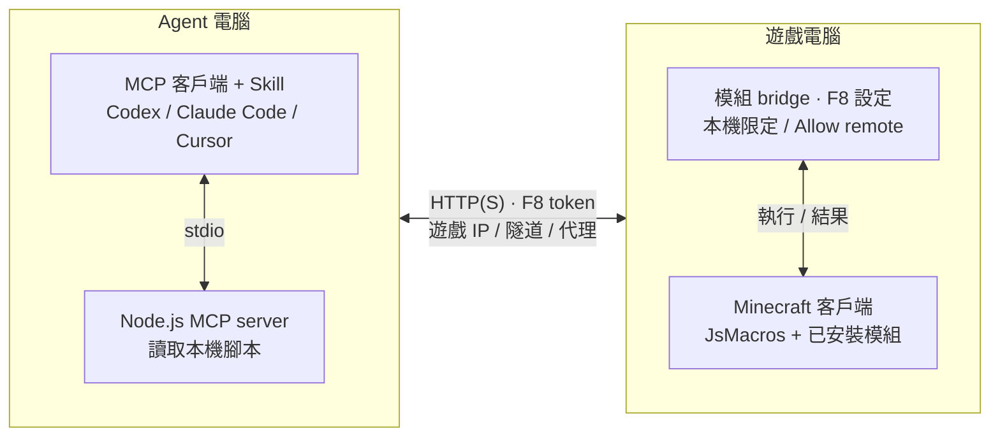

<p align="center">
  
</p>
<h1 align="center">Minecraft MCP</h1>
<p align="center">讓 AI Agent 操作你的 Minecraft 客戶端，隨時用 <code>/mcp stop</code> 接手。</p>
<p align="center">
  <a href="https://www.npmjs.com/package/@makkch/minecraft-mcp"></a>
  <a href="LICENSE"></a>
  <a href="https://github.com/MakkCH/minecraft_mcp/releases"></a>
  <a href="#remote-連線"></a>
</p>
<p align="center">
  <a href="README.md">English</a> · <a href="README.zh-Hant.md">繁體中文</a><br />
  <a href="#gallery">Gallery</a> · <a href="#系統需求">系統需求</a> · <a href="#安裝">安裝</a> · <a href="#掌握控制權">掌握控制權</a> · <a href="#remote-連線">Remote 連線</a>
</p>

Agent 透過 JsMacros 腳本操作你的遊戲角色：寫腳本、執行、看輸出、截圖、在聊天欄回報。你在自己的視角看著它玩，想接手時輸入 `/mcp stop`。

## Gallery

以下項目都是 Agent 透過 Minecraft MCP 完成的。[瀏覽全部](assets/projects/README.md)（詳細記錄為英文）。

<table>
  <tr>
    <td width="50%" valign="top">
      <a href="assets/projects/end-poem/README.md"></a>
      <h3>從空背包到終末之詩</h3>
      <p>一個 Codex Agent（<code>gpt-6-astra</code>，<code>high</code> reasoning effort）從零開始收集資源、抵達終界、擊敗終界龍。過程中它自己編寫和修改 JavaScript：採礦、交易、死亡後撿回裝備、修安全路線，最後躲在防護牆後引爆床。</p>
      <p>Java 26.3，普通難度，約 8 小時 25 分鐘。<a href="assets/projects/end-poem/README.md">完整過程與復盤</a></p>
    </td>
    <td width="50%" valign="top">
      <a href="assets/projects/f36/README.md"></a>
      <h3>F36：緊湊的 6 倍速界伏盒打包機</h3>
      <p>GPT-6 Astra 設計的 3×3×4 單物品界伏盒打包機。帶礦車的版本可以同高度、每三格平鋪；單核心獨立運作時不需要礦車。<a href="https://www.bilibili.com/video/BV1qP4y1G7mz/">真-哈基月的 3×4×4 打包機</a>只用來比較尺寸，F36 不是在它的基礎上改的。</p>
      <p>投影匯出自 Java 26.3。<a href="https://www.bilibili.com/video/BV1JBW76CEM5/">觀看影片</a> · <a href="assets/projects/f36/README.md">下載投影</a></p>
    </td>
  </tr>
</table>

## 系統需求

目前只支援 Fabric。Forge、NeoForge 和其他 Minecraft 版本尚未支援。

| Minecraft Java 版 | 下載哪一組 JAR | Baritone API Fabric（選用） |
| --- | --- | --- |
| 26.1、26.1.1、26.1.2 | 26.1 | 1.18.0 |
| 26.2 | 26.2 | 1.19.0 |
| 26.3 | 26.3 | 1.20.0 |

| 元件 | 需求 |
| --- | --- |
| Fabric Loader | 0.19.5 或更新 |
| Java | 25 或更新 |
| JsMacros Reloaded | 2.2.1，JAR 組別要和上表一致（已內含所需的 Fabric API 模組） |
| Node.js | 22 或更新，裝在執行 Agent 的電腦上 |
| Agent | Codex、Claude Code、Claude Desktop、Cursor，或任何支援 stdio MCP 的客戶端 |
| Baritone | 選用，但強烈建議 |

沒有 Baritone 也能執行腳本、截圖和直接操控玩家，只是尋路和收集資源要靠 Agent 自己寫更多腳本。

## 安裝

要裝三樣東西：

| | 裝在哪裡 | 作用 |
| --- | --- | --- |
| **模組** | Minecraft | 在遊戲裡接收並執行指令 |
| **Skill** | Agent | 教 Agent 怎麼寫腳本、有哪些 API |
| **MCP server** | Agent | 把遊戲操作變成 Agent 可以呼叫的工具 |

Agent 和遊戲在不同電腦時，Skill 和 MCP server 仍然裝在 Agent 那台，另見 [Remote 連線](#remote-連線)。

### 1. 安裝模組

1. 到 [GitHub Releases](https://github.com/MakkCH/minecraft_mcp/releases) 下載對應 Minecraft 版本的模組 JAR（不要選 `-sources.jar`）。
2. 把它和 JsMacros 放進遊戲的 `mods/` 資料夾，建議一併放入 Baritone。
3. 啟動遊戲，按 **F8** 開啟設定畫面。
4. 複製畫面上的 **token**，記下 **port**（通常是 `28473`），下面第 3 步會用到。

設定畫面也可以用 `/mcp config` 開啟；裝了 [Mod Menu](https://modrinth.com/mod/modmenu) 的話，還可以從 Mods → Minecraft MCP → Configure 進入。F8 可以在遊戲的控制設定裡改綁。

畫面上還能調整：Allow remote（預設關閉）、是否自動啟動、聊天欄的 `[AGENT]` 標籤、名稱和顏色。按 Apply 儲存時，正在執行的 Agent 任務會被停止。

<details>
<summary>找不到 <code>mods/</code> 資料夾？</summary>

| 啟動器 | 位置 |
| --- | --- |
| 官方 Minecraft Launcher | 該安裝的 Game Directory 下的 `mods/`。預設是 Windows/Linux 的 `.minecraft/mods/`，macOS 的 `~/Library/Application Support/minecraft/mods/` |
| Prism Launcher、MultiMC | 開啟該實例的 Minecraft 資料夾，通常是實例資料夾內的 `.minecraft/mods/` |
| 其他啟動器 | 開啟該實例的遊戲資料夾，裡面的 `mods/` |

</details>

### 2. 安裝 Skill

```sh
npx skills add MakkCH/minecraft_mcp --skill minecraft-mcp -g
```

依提示選擇你的 Agent。也可以直接指定：`-a codex`、`-a claude-code` 或 `-a cursor`。`-g` 表示裝到使用者層級，所有專案都能用；不加則只裝到目前專案。

[Skills CLI](https://github.com/vercel-labs/skills) 需要 Node.js 22.20 或更新。如果你的客戶端不支援 Skill，把 [SKILL.md](skills/minecraft-mcp/SKILL.md) 當作指令提供給 Agent，並確保它讀得到裡面引用的檔案。

### 3. 加入 MCP server

在你的 Agent 客戶端新增一個 **stdio** MCP server，填入第 1 步拿到的 token 和 port。

<details open>
<summary>Codex</summary>

把以下內容加到 `~/.codex/config.toml`。已經有 `minecraft_mcp` 項目的話，改原來的，不要重複新增。（[Codex MCP 文件](https://developers.openai.com/codex/mcp)）

```toml
[mcp_servers.minecraft_mcp]
command = "npx"
args = ["-y", "@makkch/minecraft-mcp@latest"]

[mcp_servers.minecraft_mcp.env]
MINECRAFT_MCP_TOKEN = "YOUR_TOKEN"
MINECRAFT_MCP_PORT = "28473"
```

</details>

<details>
<summary>Claude Code</summary>

（[MCP 文件](https://code.claude.com/docs/en/mcp)）

```sh
claude mcp add --env MINECRAFT_MCP_TOKEN=YOUR_TOKEN \
  --env MINECRAFT_MCP_PORT=28473 --transport stdio --scope user minecraft_mcp \
  -- npx -y @makkch/minecraft-mcp@latest
```

</details>

<details>
<summary>Cursor／Claude Desktop</summary>

Cursor 加到 `~/.cursor/mcp.json` 或專案的 `.cursor/mcp.json`；Claude Desktop 加到 `claude_desktop_config.json`。（[Cursor 文件](https://cursor.com/docs/mcp) · [Claude Desktop 指南](https://modelcontextprotocol.io/docs/develop/connect-local-servers)）

```json
{
  "mcpServers": {
    "minecraft_mcp": {
      "command": "npx",
      "args": ["-y", "@makkch/minecraft-mcp@latest"],
      "env": {
        "MINECRAFT_MCP_TOKEN": "YOUR_TOKEN",
        "MINECRAFT_MCP_PORT": "28473"
      }
    }
  }
}
```

</details>

<details>
<summary>其他客戶端（設定表單）</summary>

| 欄位 | 值 |
| --- | --- |
| 名稱 | `minecraft_mcp` |
| 傳輸方式 | `stdio` |
| 執行程式 | `npx` |
| 參數 | `-y` 和 `@makkch/minecraft-mcp@latest`（兩個獨立參數） |
| 環境變數 | `MINECRAFT_MCP_TOKEN`、`MINECRAFT_MCP_PORT` |

</details>

幾點提醒：

- `npx -y @makkch/minecraft-mcp@latest` 是給 MCP 客戶端執行的。自己在終端跑它，只會得到一個等待輸入的程序。
- `@latest` 選用 npm 標記為 `latest` 的版本。想固定版本就換成明確的版本號，並確認它和模組[相容](#版本與相容性)。
- token 等同於遊戲的控制權，不要提交到共用的儲存庫。

### 4. 試試看

重啟客戶端的 MCP 連線，開一個新對話，然後說：

> 檢查我的 Minecraft 客戶端，告訴我你看到了什麼。

> 在附近收集一些木頭，並在聊天欄回報進度。

沒反應的話，見[疑難排解](#疑難排解)。

<details>
<summary>其他安裝方式：Release 壓縮檔、Codex 外掛</summary>

**壓縮檔（`.tgz`）**：從 Release 下載並解壓，在 MCP 設定中把執行程式改為 `node`，參數改為 `src/server.mjs` 的絕對路徑，環境變數不變。Skill 仍依第 2 步安裝。

**Codex 外掛**：仍然提供，內含 Skill，但不建議新使用者採用。要為每個遊戲實例分別設定 token 和 port，請用上面的獨立安裝（[Codex MCP 設定](https://developers.openai.com/codex/mcp#plugin-provided-mcp-servers)）。安裝方式見 [Codex 文件](https://developers.openai.com/plugins/build/plugins)。

如果你已經在用外掛，又想改用上面的獨立安裝：先停用外掛內附的 MCP server，並且只保留一份 Skill。

</details>

## 掌握控制權

| 在 Minecraft 裡 | 效果 |
| --- | --- |
| `/mcp stop` | 停用 Agent、取消 MCP 腳本、釋放按鍵 |
| `/mcp start` | 重新允許 Agent 操作 |
| `/mcp status` | 顯示是否啟用，以及執行中的任務數 |
| `/mcp config` 或 F8 | 開啟設定畫面 |

- 停用後 Agent 仍然可以截圖，但不能操作。
- 離開或切換世界時，進行中的任務會自動取消。
- `[AGENT]` 訊息只顯示在你自己的聊天欄，不會傳到多人伺服器。
- 模組介面目前只有英文。

模組不新增任何方塊、物品或實體，移除時不需要處理存檔。但 Agent 的操作和你親手玩一樣，會真實影響世界和背包。

## Remote 連線

Agent 和遊戲可以在不同電腦上。MCP server 和 Skill 留在 Agent 那台，透過網路連到遊戲電腦上的模組：



自訂地址需要 MCP server 0.4.0 或更新。Allow remote 需要模組 0.4.0 或更新。

### 1. 讓 Agent 電腦連得到遊戲

三種做法，選一種：

**直接連線**：在 F8 設定中開啟 **Allow remote** 並按 Apply，模組會開始接受來自其他電腦的連線。Agent 連到 `http://遊戲電腦IP:28473/`。記得讓防火牆放行這個 port。

**SSH 隧道**：Allow remote 保持關閉，在 Agent 電腦執行以下指令並保持開啟。Agent 連到 `http://127.0.0.1:38473/`。

```sh
ssh -N -L 38473:127.0.0.1:28473 user@game-host
```

**HTTPS 反向代理**：把一個 URL 前綴轉發到模組的 `/status`、`/command`、`/output`，並保留 `Authorization` header。

### 2. 把地址填進 MCP 設定

在[安裝](#3-加入-mcp-server)時的設定裡，把 `MINECRAFT_MCP_PORT` 換成 `MINECRAFT_MCP_URL`。以 Codex 為例：

```toml
[mcp_servers.minecraft_mcp]
command = "npx"
args = ["-y", "@makkch/minecraft-mcp@latest"]

[mcp_servers.minecraft_mcp.env]
MINECRAFT_MCP_URL = "http://GAME_COMPUTER_IP:28473/"
MINECRAFT_MCP_TOKEN = "YOUR_TOKEN"
```

把範例 URL 換成遊戲地址、SSH 隧道地址或 HTTPS 代理 URL。其他客戶端填相同的環境變數，然後重啟 MCP 連線。

| 環境變數 | 說明 |
| --- | --- |
| `MINECRAFT_MCP_TOKEN` | F8 畫面上的 token，必填 |
| `MINECRAFT_MCP_PORT` | 連本機時的 port，預設 `28473` |
| `MINECRAFT_MCP_URL` | 完整的 bridge 地址，設定後會取代 port |

`MINECRAFT_MCP_URL` 接受 HTTP 或 HTTPS、網域、IP（含 IPv6）、自訂 port 和路徑前綴，例如 `https://game-host.example/bridge/` 或 `http://[::1]:38473/`。不能帶帳號密碼、query 或 fragment，也不會跟隨重新導向。`node src/server.mjs --help` 可以查看摘要。

### 安全須知

- **腳本擁有 Minecraft 程序的全部權限**，只讓你信任的 Agent 連線。
- token 是唯一的驗證方式。純 HTTP 不加密 token 和腳本內容，經過不可信任的網路時請用 SSH 隧道或 HTTPS。
- 開啟 Allow remote 後仍然要求 token，並拒絕帶有 `Origin` header 的請求。

### 行為細節

- 中斷 MCP 連線不會停止遊戲裡的腳本，要用 `stop` 工具或 `/mcp stop`。
- 多個 Agent 連到同一個遊戲時，共用同一位玩家和同一批任務；每個任務的輸出只應由一方讀取。
- `execute(file=...)` 讀的是 Agent 電腦上的檔案，內容會傳到遊戲那邊執行。

<a id="連線疑難排解"></a>

## 疑難排解

| 狀況 | 怎麼處理 |
| --- | --- |
| Connection refused | 確認啟動的是裝了模組的那個實例，並核對 F8 上的 port |
| Authentication failed／HTTP 401 | token 和 F8 上的不一致。改好後重啟 MCP 連線 |
| Agent control disabled | 在遊戲裡輸入 `/mcp start` |
| Agent 找不到工具 | 確認 MCP server 已啟用、Node.js 已安裝，然後開一個新對話 |
| Port already in use | 同時開多個遊戲實例時，在 F8 給每個實例設不同的 port |
| Incompatible protocol | 把模組和 MCP server 更新到[相容的版本](#版本與相容性) |
| Remote 連不上／404 | 依序檢查：Allow remote 是否開啟、IP 和 port、防火牆、隧道或代理、URL 前綴 |

## 更新

| 元件 | 做法 |
| --- | --- |
| 模組 | 從 [Releases](https://github.com/MakkCH/minecraft_mcp/releases) 下載新 JAR，關閉遊戲後替換 `mods/` 裡的舊檔 |
| MCP server（npm） | 用 `@latest` 的話，重啟 MCP 連線即可；固定版本的話，先改設定裡的版本號 |
| Skill | `npx skills update minecraft-mcp -g`（專案層級安裝改用 `-p`） |
| 壓縮檔 | 替換解壓後的資料夾，重啟 MCP 連線 |
| Codex 外掛 | 從原本的安裝來源更新，再開新對話 |

更新不會覆蓋你在遊戲裡和 Agent 客戶端裡的設定。更新 MCP server 前，先確認它和你的模組版本相容。

## 版本與相容性

模組和 Agent 套件（MCP server、Skill、Codex 外掛）的版本號前兩段保持一致，第三段各自遞增：

- **前兩段相同就相容。** 例如模組 0.4.2 可以搭配 MCP server 0.4.0。
- 兩邊之間的介面有變動時，前兩段一起提升。

其他版本系列只要使用 bridge protocol `1`，也能互連。

## 開發

```text
src/                  MCP server（Node.js，stdio）
skills/minecraft-mcp/ Skill：指令、API 索引、工具腳本、範例
mod/                  Fabric 客戶端模組
tests/                協定測試與真實客戶端整合測試
scripts/              開發工具
assets/               圖示、README 素材、Gallery 項目
.codex-plugin/        Codex 外掛資訊
.mcp.json             MCP server 啟動設定
```

### 建置模組

需要 JDK 25。每個 Minecraft 版本組別各建一個 JAR，輸出在 `build/<profile>/libs/`：

```sh
./gradlew build -PmcProfile=26.1
./gradlew build -PmcProfile=26.2
./gradlew build -PmcProfile=26.3   # 預設
```

Windows 用 `gradlew.bat`。26.1 組別預設對照 26.1.2 建置，可用 `-PmcVersion=26.1` 或 `-PmcVersion=26.1.1` 指定同組的其他版本。

### 打包 Agent 套件

需要 Node.js 22 或更新：

```sh
npm ci
mkdir -p build/distributions
npm pack --pack-destination build/distributions
```

套件包含 MCP server、依賴、Skill、外掛資訊、README 和圖示；不包含 Gallery 項目的檔案。

### 測試

| 指令 | 檢查內容 | 需要 |
| --- | --- | --- |
| [`npm test`](tests/protocol.test.mjs) | MCP 協商、工具列表、參數驗證 | 無 |
| [`npm run test:runtime`](tests/runtime.test.mjs) | 腳本執行、遊戲執行緒回呼、模組探索、截圖 | 執行中的遊戲 |
| [`npm run test:mod`](tests/mod.test.mjs) | 設定畫面、token 更新與驗證、Mod Menu 入口（如有安裝） | 執行中的遊戲 |
| [`npm run test:live`](tests/live.test.mjs) | 移動、Baritone 導航、輸出、取消、標記、玩家接手 | 執行中的遊戲、Baritone、已載入的世界 |

後三項要連到一個專門用來測試的 Minecraft 客戶端，並透過環境變數傳入它的 port 和 token。啟動測試客戶端：

```sh
./gradlew runClient -PmcProfile=26.1 -PmcpRunDir=/absolute/test-instance
```

不指定 `-PmcpRunDir` 時，執行目錄會建在系統暫存資料夾，並依版本區分。同時開多個測試客戶端時，給每個設不同的 port 和 token。

### 其他

- 五個 MCP 工具：`execute`、`read_output`、`stop`、`screenshot`、`chat`。
- 每次 `execute` 都在新的 JsMacros context 裡執行。腳本可以長時間運行並持續產生輸出，但頂層變數不會保留到下一次呼叫。
- Banner 場景由 GPT-6 Astra 使用 Minecraft MCP 在 Minecraft 中搭建並拍攝。

[Skill](skills/minecraft-mcp/SKILL.md) · [API 索引](skills/minecraft-mcp/references/api-index.txt) · [模組探索](skills/minecraft-mcp/references/mods.md) · [工具腳本](skills/minecraft-mcp/scripts) · [範例](skills/minecraft-mcp/examples)

## 授權

[MIT](LICENSE) © 2026 [Mak](https://github.com/MakkCH)。隨附的第三方依賴保留各自的授權。
