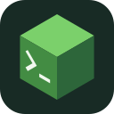
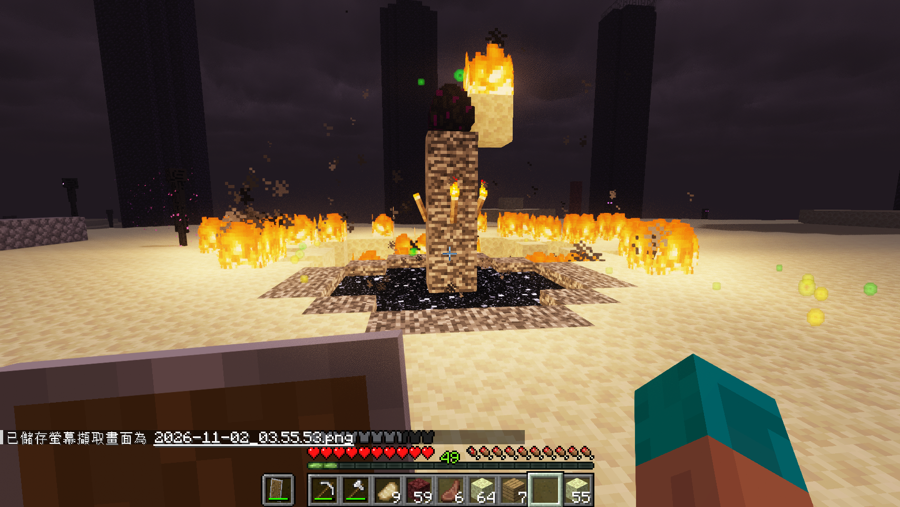
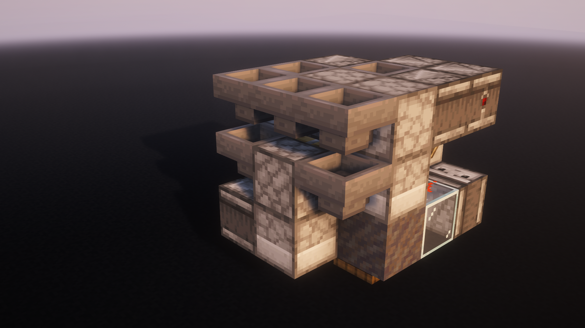

<p align="center">
  
</p>

# Minecraft MCP

[English](README.md) · [繁體中文](README.zh-Hant.md)

讓 AI Agent 操作你的 Minecraft 客戶端，你可以觀看、一起遊玩，隨時接手。

Minecraft MCP 將遊戲連接到支援 MCP 的 Agent。你可以請它探索、收集資源、建造，或除錯腳本；從自己的玩家視角觀看過程，並隨時用 `/mcp stop` 取回控制權。

專案分為兩部分：Minecraft 客戶端模組，以及包含 MCP server 和 Skill 的 Agent 套件。兩者都在你的電腦上執行，可以獨立安裝、更新。套件內附 Codex 外掛；Claude Code、Claude Desktop、Cursor 和其他支援本機 MCP 的客戶端也能連接同一個 server。

## Gallery

從生存遊玩到遊戲內工程，這些是使用 Minecraft MCP 完成的項目。[瀏覽完整展示](assets/projects/README.md)（項目詳細記錄為英文）。

### 從空背包到終末之詩

在 2026 年 11 月 1–2 日，一個使用 `gpt-6-astra`、`high` reasoning effort 的 Codex Agent，透過 Minecraft MCP 收集資源、抵達終界、擊敗終界龍並進入終末之詩。它在遊玩過程中自行編寫、修改 JavaScript，完成採礦、交易、死亡後回收裝備、修築安全路線，最後在防護牆後抓準時機引爆床。



這次在 Java 26.3 普通難度下完成，耗時約 8 小時 25 分鐘。 [完整過程、時間線與復盤](assets/projects/end-poem/README.md)。

### F36：緊湊的 6 倍速界伏盒打包機

GPT-6 Astra 使用 Minecraft MCP 開發了 F36，一台 3×3×4 的單物品界伏盒打包機。[真-哈基月的 3×4×4 打包機（BV1qP4y1G7mz）](https://www.bilibili.com/video/BV1qP4y1G7mz/)僅用作尺寸比較基線，F36 並非在該設計上改造。帶礦車版本可同高度、每三格平鋪；獨立運作的單核心可以不使用礦車。



三份投影匯出自 Java 26.3。可以[觀看影片](https://www.bilibili.com/video/BV1JBW76CEM5/)，或[下載投影自行嘗試](assets/projects/f36/README.md)。

## 可以做什麼

- 一起遊玩。 Agent 操作真實客戶端，透過本機聊天訊息回報進度。
- 用腳本自動化。 JsMacros 在遊戲內執行 JavaScript，Agent 使用平常的編輯器、檔案與 shell 開發腳本。
- 觀察與除錯。 擷取遊戲畫面、增量讀取腳本輸出，在世界中繪製標記。
- 使用已安裝的模組。 Skill 教 Agent 探索模組 API；Baritone 提供導航、採礦與建造自動化。
- 隨時接手。 在 Minecraft 內停止 Agent 腳本並釋放控制。

## 系統需求

客戶端模組支援以下版本組別。請依 Release 說明下載相符的模組與 JsMacros JAR；MCP server 和 Skill 在各組別間共用。

| Minecraft Java 版 | JAR 組別 | Baritone API Fabric（選用） |
| --- | --- | --- |
| 26.1、26.1.1、26.1.2 | 26.1 | 1.18.0 |
| 26.2 | 26.2 | 1.19.0 |
| 26.3 | 26.3 | 1.20.0 |

僅支援表中列出的版本；未來的 26.x 版本及其他模組載入器仍需另外驗證。

| 元件 | 需求 |
| --- | --- |
| 模組載入器 | Fabric Loader 0.19.5 或更新版本 |
| Java | 25 或更新版本 |
| 腳本模組 | JsMacros Reloaded 2.2.1，須符合上表的 JAR 組別 |
| Agent 執行環境 | Node.js 22 或更新版本，且可從 `PATH` 找到 |
| Agent 應用程式 | Codex、Claude Code、Claude Desktop、Cursor，或其他支援本機 stdio MCP 的客戶端 |
| 建議模組 | 與 Minecraft 版本相符的 Baritone |

Baritone 並非必要，但強烈建議安裝。 沒有它仍可執行腳本、截圖與直接操控玩家；導航與資源收集則需要更多腳本。JsMacros Reloaded 2.2.1 已包含本模組所需的 Fabric API 模組。

## 開始使用

到 [GitHub Releases](https://github.com/MakkCH/minecraft_mcp/releases) 下載同一 Release 列出的 客戶端模組 JAR（`.jar`，不要選 sources JAR）及 Agent 套件（`.tgz`）。請先閱讀版本及依賴需求。一般使用者不必從原始碼建置；建置方式見[開發](#開發)。

### 1. 安裝 Minecraft 模組

1. 建立或選擇符合 Release 需求的 Fabric 安裝，在啟動器中開啟該實例的遊戲資料夾。
2. 將 Minecraft MCP JAR 放入 `mods/`，並安裝 JsMacros，建議同時安裝 Baritone。
3. 啟動 Minecraft。若有安裝 [Mod Menu](https://modrinth.com/mod/modmenu)，選擇 Mods → Minecraft MCP → Configure。也可按 F8，或進入世界後輸入 `/mcp config`。
4. 複製 token 並記下 port，稍後用來配對 Agent。

請使用實際啟動的安裝所對應的遊戲資料夾：

| 啟動器 | JAR 放置位置 |
| --- | --- |
| 官方 Minecraft Launcher | 該安裝的 Game Directory 下的 `mods/`。預設通常是 Windows/Linux 的 `.minecraft/mods/`，或 macOS 的 `~/Library/Application Support/minecraft/mods/`。 |
| Prism Launcher 或 MultiMC | 開啟所選實例的 Minecraft 資料夾，使用其中的 `mods/`；通常位於實例資料夾內的 `.minecraft/mods/`。 |
| 其他啟動器 | 開啟所選實例的遊戲資料夾，使用其中的 `mods/`。 |

三個設定入口都開啟同一畫面，Mod Menu 為選用。設定畫面也可調整自動啟動、`[AGENT]` 標籤、可選名稱與聊天顏色。按 Apply 儲存時會停止正在執行的 Agent 任務。F8 可在 Minecraft 的控制設定中重新綁定。

### 2. 安裝 Agent 套件

一般 MCP 客戶端也可使用下列設定執行 npm 套件。在客戶端填入步驟 1 的 token 與 port。此入口使用環境變數，不讀取 `connection.json`。套件包含 Skill，MCP 初始化指示會提供其安裝路徑。

```json
{
  "mcpServers": {
    "minecraft_mcp": {
      "command": "npx",
      "args": [
        "-y",
        "@makkch/minecraft-mcp@0.2.3"
      ],
      "env": {
        "MINECRAFT_MCP_TOKEN": "YOUR_TOKEN",
        "MINECRAFT_MCP_PORT": "28473"
      }
    }
  }
}
```

或使用 GitHub Release 壓縮檔，內含 MCP server、執行依賴、Skill 與 Codex 外掛資訊。將它解壓縮至固定位置，再依你的 Agent 選擇下方設定方式。指令使用 macOS/Linux shell 語法；Windows 請使用使用者資料夾下對應的位置。

將壓縮檔路徑替換成實際下載位置：

```sh
mkdir -p ~/plugins/minecraft-mcp
tar -xzf /path/to/downloaded-agent-package.tgz \
  -C ~/plugins/minecraft-mcp --strip-components=1
```

<details>
<summary>Codex：安裝內附外掛</summary>

建立 `~/.agents/plugins/marketplace.json`，填入以下內容。如果已有 marketplace 檔案，只需把 Minecraft 項目加入原本的 `plugins` 陣列，保留既有名稱與其他項目。

```json
{
  "name": "personal",
  "interface": {"displayName": "Personal"},
  "plugins": [{
    "name": "minecraft-mcp",
    "source": {"source": "local", "path": "./plugins/minecraft-mcp"},
    "policy": {"installation": "AVAILABLE", "authentication": "ON_INSTALL"},
    "category": "Productivity"
  }]
}
```

這個個人 marketplace 的 `./plugins/minecraft-mcp` 從使用者家目錄解析為 `~/plugins/minecraft-mcp`，不是從 `.agents/plugins/` 解析。這只會將外掛加入本機目錄，不會公開發布。其他方式請參閱 [Codex 外掛安裝文件](https://developers.openai.com/plugins/build/plugins)。

安裝並啟用：

```sh
codex plugin add minecraft-mcp@personal
```

若 marketplace 不叫 `personal`，請替換成實際名稱。也可在桌面應用程式的 Plugins 目錄中，從該來源安裝 Minecraft MCP；若尚未顯示，重新開啟目錄或重啟應用程式。

外掛已包含 Skill。若之前手動設定過 Minecraft MCP，確認外掛正常後，移除舊的 MCP 註冊及獨立 Skill 副本。

</details>

<details>
<summary>Claude Code、Claude Desktop、Cursor 與其他 MCP 客戶端</summary>

設定一個本機 stdio MCP server，用 `node` 執行解壓縮後 `src/plugin.mjs` 的絕對路徑。此入口會讀取步驟 3 建立的連線檔案。

Cursor：將以下內容加入 `~/.cursor/mcp.json`（所有專案）或 `.cursor/mcp.json`（單一專案），保留原有 server 設定。參閱 [Cursor MCP 文件](https://cursor.com/docs/mcp)。

```json
{
  "mcpServers": {
    "minecraft_mcp": {
      "type": "stdio",
      "command": "node",
      "args": ["/absolute/path/to/minecraft-mcp/src/plugin.mjs"]
    }
  }
}
```

Claude Desktop：在 `claude_desktop_config.json` 的 `mcpServers` 中使用相同的 `command` 與 `args`，省略 `type` 欄位。參閱[本機 MCP 設定指南](https://modelcontextprotocol.io/docs/develop/connect-local-servers)。

Claude Code：使用 CLI 註冊（[MCP 文件](https://code.claude.com/docs/en/mcp)）：

```sh
claude mcp add --transport stdio --scope user minecraft_mcp \
  -- node /absolute/path/to/minecraft-mcp/src/plugin.mjs
```

不使用外掛的 Codex：手動註冊：

```sh
codex mcp add minecraft_mcp \
  -- node /absolute/path/to/minecraft-mcp/src/plugin.mjs
```

其他客戶端的設定格式可能不同，但執行指令與入口相同。此方式連接電腦上的程序，請使用客戶端的本機 MCP 功能。

另外，透過客戶端的 Skill 功能安裝完整的 `skills/minecraft-mcp` 資料夾。手動設定 Codex 時，可複製到 `${CODEX_HOME:-$HOME/.codex}/skills/`。若客戶端不支援 Skill，請將 `SKILL.md` 作為指令提供，並讓 Agent 能讀取其引用的檔案。資料夾包含按需查閱的 API 索引、工具腳本及範例。

</details>

### 3. 將 Agent 與遊戲配對

若使用上述 npm 設定，已透過 `env` 配對，可略過下方連線檔案。

建立 `~/.config/minecraft-mcp/connection.json`（包含上層資料夾），填入 Minecraft 設定畫面的值。Windows 的 `~` 指使用者資料夾，通常為 `C:\Users\YourName`。

```json
{
  "port": 28473,
  "token": "PASTE_YOUR_TOKEN_FROM_MINECRAFT_SETTINGS"
}
```

在 macOS/Linux，可用 `chmod 600 ~/.config/minecraft-mcp/connection.json` 限制讀取權限。這是 Agent 的連線檔案；Minecraft 的設定由遊戲介面自行管理，兩者不共用設定檔。Token 應放在套件外，避免更新或分享時一併包含。

重新啟動客戶端的 MCP 連線並開啟新的本機對話；若客戶端有開關，啟用 Minecraft MCP。可以試著說：

> 檢查我的 Minecraft 客戶端，告訴我你看到了什麼。

> 在附近收集一些木頭，並在聊天欄回報進度。

> 在這個位置放一個可見標記，讓我之後能找到。

## 掌握控制權

| Minecraft 內的操作 | 功能 |
| --- | --- |
| `/mcp stop` | 停用 Agent 操作、取消腳本並釋放控制 |
| `/mcp start` | 重新允許 Agent 操作 |
| `/mcp status` | 顯示控制是否啟用及目前任務數 |
| `/mcp config` 或 F8 | 開啟連線與聊天設定 |
| Mod Menu → Minecraft MCP → Configure | 開啟相同設定畫面；Done 或 Esc 返回 Mod Menu |

以上均為客戶端指令。模組介面目前僅提供英文。`[AGENT]` 訊息只顯示在本機聊天欄，不會傳送到多人伺服器。停用控制後仍可截圖；離開或切換世界會取消舊任務。

模組不新增方塊、物品、實體或世界生成內容，移除時不需轉換存檔。Agent 的實際操作仍會像玩家操作一樣，影響世界與背包。

## 連線疑難排解

| 狀況 | 檢查方式 |
| --- | --- |
| Connection refused | 確認啟動了正確實例，並核對 F8 設定中的 port |
| Authentication failed | 將相同 token 填入 Agent 連線設定，重啟 MCP 連線 |
| Agent control disabled | 想恢復操作時輸入 `/mcp start` |
| 找不到外掛或工具 | 確認已啟用外掛或 MCP server、已安裝 Node.js，並開啟新的本機對話 |
| Port already in use | 為同時執行的每個實例分配不同 port |
| Incompatible protocol | 將模組與 MCP 外掛更新至相容版本 |

Codex 外掛與上述壓縮檔手動設定皆使用 `src/plugin.mjs`，預設讀取 `~/.config/minecraft-mcp/connection.json`。可用 `MINECRAFT_MCP_CONNECTION` 指定其他檔案；明確設定的 `MINECRAFT_MCP_PORT` 與 `MINECRAFT_MCP_TOKEN` 優先於檔案內容。若要完全透過環境變數設定連線，可直接執行 `src/server.mjs`。

Minecraft 與 MCP server 必須在同一台電腦上執行。模組僅監聽 `127.0.0.1` 並要求 token；腳本具有 Minecraft 程序的權限，請連接你信任的 Agent。

## 更新

從 [GitHub Releases](https://github.com/MakkCH/minecraft_mcp/releases) 下載相容的模組與 Agent 套件後：

- Minecraft 模組： 關閉 Minecraft，替換 `mods/` 中的 JAR。
- Codex 外掛： 替換解壓縮後的套件，再執行 `codex plugin add minecraft-mcp@personal`，並開啟新對話。
- 其他客戶端或手動 MCP 設定： 替換套件、更新獨立安裝的 Skill 副本，並重啟 MCP 程序。

Minecraft 設定及 Agent 連線檔案都位於安裝套件外。模組與外掛有獨立版本號，使用有版本標記的通訊協定互通。

<details>
<summary>從舊版 JsMacros bootstrap 安裝遷移</summary>

停止並移除 `minecraft_mcp` JsMacros service 及其 bootstrap/helper JAR。安裝客戶端模組，再依上述步驟配對。將舊的 `MINECRAFT_MCP_CONFIG` 設定換成新的 Agent 端連線設定；其他 JsMacros 腳本與 service 可保留。

</details>

## 開發

儲存庫包含一個 Agent 外掛及配套 Minecraft 模組：

```text
.codex-plugin/         Codex 外掛資訊
.mcp.json             MCP server 啟動設定
src/                  Node.js MCP server 與外掛入口
skills/minecraft-mcp/ Agent 指令、API 索引、工具腳本與範例
mod/                  Fabric 客戶端模組
assets/               圖示與項目展示
assets/projects/      每個項目的說明、圖片與下載檔案
scripts/              開發工具
tests/                MCP 協定與真實客戶端整合檢查
```

外掛資訊、Skill 與 MCP 啟動設定位於外掛根目錄；`src/` 負責 MCP，`mod/` 負責遊戲整合。

使用 JDK 25 建置模組。每個 profile 由共用 bridge 與小型客戶端適配層產生獨立 JAR：

```sh
./gradlew build -PmcProfile=26.1
./gradlew build -PmcProfile=26.2
./gradlew build -PmcProfile=26.3
```

預設 profile 為 26.3；Windows 使用 `gradlew.bat`。安裝 `build/<profile>/libs/` 中非 `-sources.jar` 的 JAR。26.1 profile 預設對照 26.1.2 建置，開發時可用 `-PmcVersion=26.1` 或 `-PmcVersion=26.1.1` 選擇同組其他版本。

使用 Node.js 22 或更新版本打包 Agent 外掛：

```sh
npm ci
mkdir -p build/distributions
npm pack --pack-destination build/distributions
```

套件包含 server、執行依賴、Skill、外掛資訊、README 與圖示。項目說明、截圖及投影下載保留在儲存庫中，不打包進 Agent 套件。套件不包含 Minecraft、啟動器實例或配對憑證。

圖示原始檔為 `assets/icon.svg`。模組與外掛均使用其透明背景的 512 × 512 PNG 匯出 `assets/icon.png`，Gradle 會在建置時複製到模組資源目錄。

[`npm test`](tests/protocol.test.mjs) 透過官方 MCP SDK 檢查真實的 stdio server。下列檢查需要正在執行的專用測試 Minecraft 客戶端，並設定 MCP port/token 環境變數：

- [`npm run test:runtime`](tests/runtime.test.mjs)：腳本執行、遊戲執行緒回呼、模組探索與截圖。
- [`npm run test:mod`](tests/mod.test.mjs)：設定 UI、token 更新及驗證；若安裝 Mod Menu，也檢查其設定入口與返回操作。
- [`npm run test:live`](tests/live.test.mjs)：移動、Baritone 導航、輸出、取消、標記與玩家接手。需要 Baritone 及已載入的世界。

測試不使用模擬遊戲客戶端。可用 `./gradlew runClient -PmcProfile=26.1 -PmcpRunDir=/absolute/test-instance` 啟動獨立開發客戶端；預設執行目錄依版本區分，位於作業系統暫存資料夾。為各測試客戶端設定獨立的 port/token，並傳入測試。

五個 MCP 工具為 `execute`、`read_output`、`stop`、`screenshot` 和 `chat`。每次執行都建立新的 JsMacros context；腳本可以持續執行並產生增量輸出，但頂層變數不會跨呼叫共用。

[Agent Skill](skills/minecraft-mcp/SKILL.md) · [API 索引](skills/minecraft-mcp/references/api-index.txt) · [模組探索](skills/minecraft-mcp/references/mods.md) · [工具腳本](skills/minecraft-mcp/scripts) · [範例](skills/minecraft-mcp/examples)

## 授權

[MIT](LICENSE) © 2026 [Mak](https://github.com/MakkCH)。隨附的第三方依賴保留各自授權。
