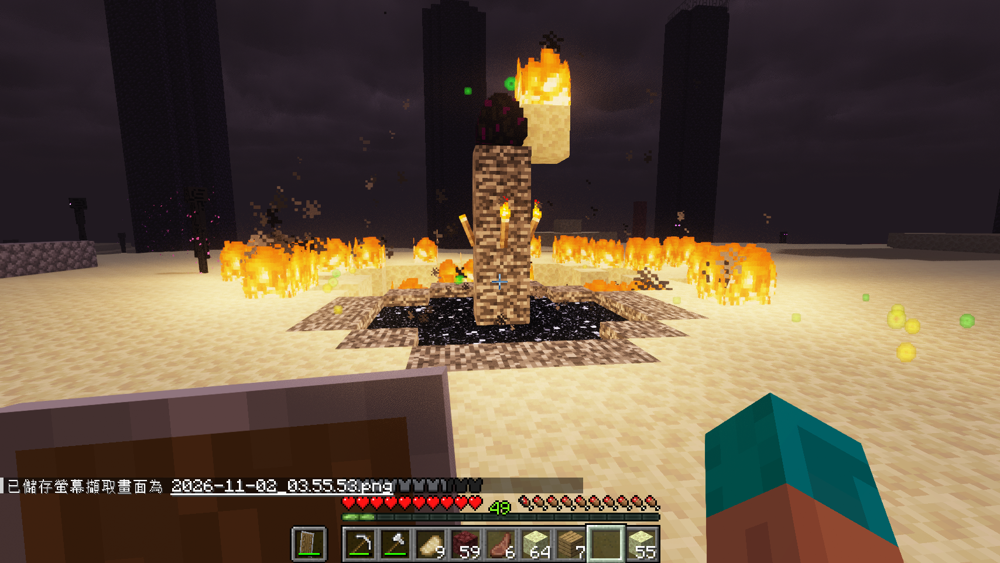
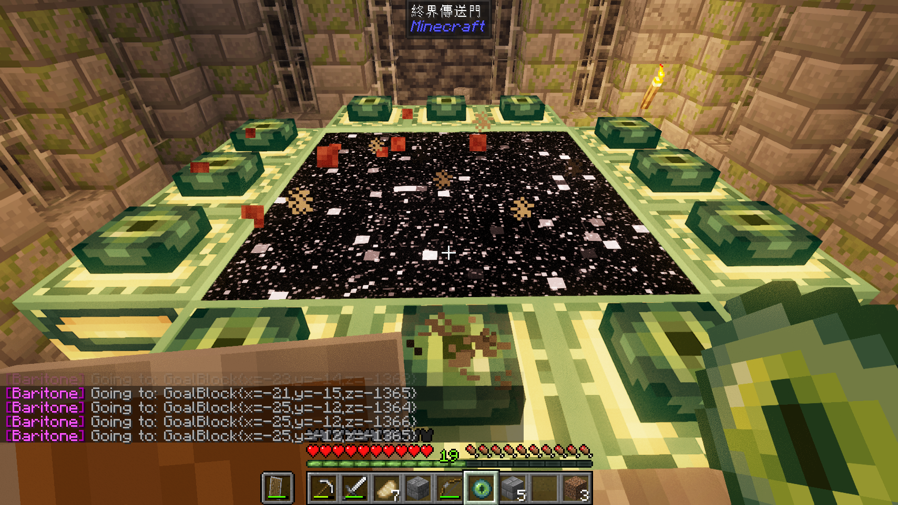
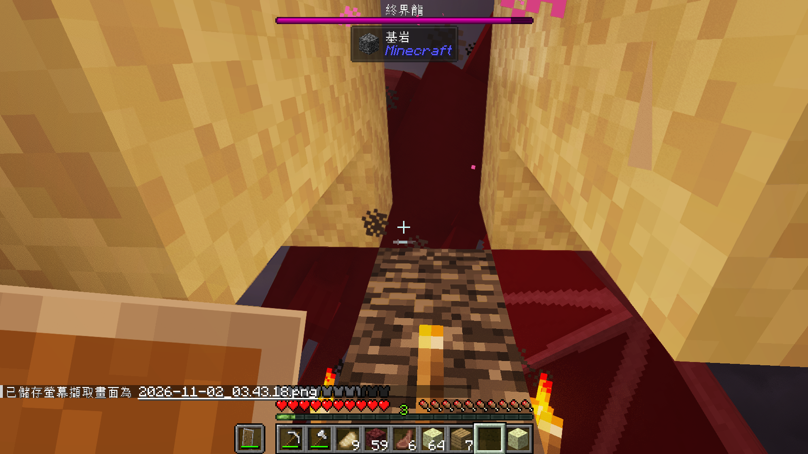
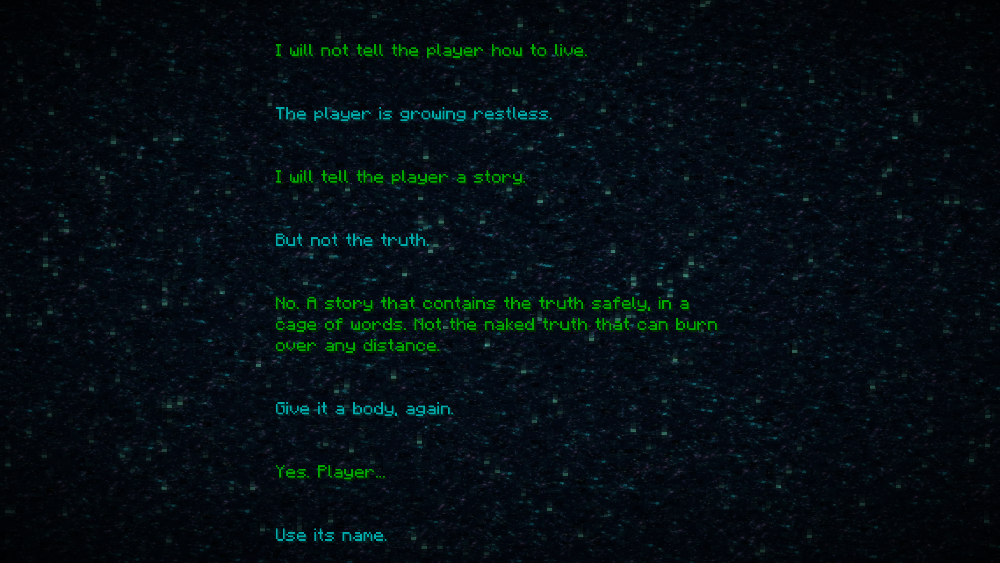

# From an empty inventory to the End Poem

[All projects](../README.md) · [Minecraft MCP](../../../README.md)

**To our knowledge, this may be the first documented Minecraft completion from a fresh world by a single general-purpose coding agent using an open-source game-control harness, with progression and dragon-combat code written autonomously during the run rather than provided in advance.**

On **November 1–2, 2026**, a Codex agent running **`gpt-6-astra`** with **`high` reasoning effort** used Minecraft MCP to gather resources, reach the End, defeat the Ender Dragon and enter the End Poem. It wrote and revised its own JavaScript throughout the run: mining and trading, recovering equipment after deaths, building safer routes, and eventually timing bed explosions behind a protective wall.

*About 8 hours 21 minutes into the run — The dragon is defeated, the exit portal is open, and the player has survived the final fight.*

| Run | Recorded result |
| --- | --- |
| Starting state | Survival mode, empty inventory |
| Difficulty | **Normal**; the recorded in-game difficulty query returned `2` |
| Environment | Local single-player world with an integrated server; Minecraft Java 26.3, Fabric Loader 0.19.5, JsMacros Reloaded 2.2.1, Baritone API Fabric 1.20.0 |
| Completion | Dragon health reached zero; the exit portal opened; the End Poem was confirmed on screen |
| Elapsed time | About **8 hours 25 minutes** |
| Script execution | **856 tasks**, with **2,060 task responses** including follow-up output reads |
| Milestone journal | **19 screenshots** with timestamps and captions; four are selected here |

Elapsed time includes planning, debugging, recovery and pauses, measured from the initial request to confirmation of the ending screen.

The agent could inspect structured game state and Java APIs, use Baritone, write scripts with the local filesystem and shell, capture screenshots, and pause the single-player game while handling dangerous situations. It also read integrated-server state when checking completion. This was not a vision-only or continuously running real-time benchmark. The initial request was to finish Minecraft; a later request added the screenshot journal. This is a documented demonstration of one run with those capabilities.

<strong>Run timeline and selected screenshots</strong>

The timeline combines timestamped task output, progress messages and the screenshot journal. Times below are approximate elapsed hours and minutes from the initial request. Screenshots are unedited captures from the player's client.

| Elapsed time (h:mm) | Milestone |
| --- | --- |
| 0:00 | Started with an empty inventory; gathered wood, food, iron and equipment. |
| 0:32 | Activated a Nether portal and entered the Nether. |
| 0:40 | Located a Nether fortress and approached its blaze spawner. |
| 0:43–2:14 | Died during the initial approach and recovery attempts. Rebuilt equipment, stored valuables, established a respawn point, and added a low-health pause guard. |
| 2:46–3:09 | Recovered equipment through sheltered routes, fought blazes, and banked the first two blaze rods. |
| 3:49 | Died after a ghast knocked the player down; previously banked pearls and rods remained safe. |
| 5:01 | Finished the pearl-gathering phase with **15 ender pearls**, after repeated gold-mining and piglin-bartering trips. |
| 5:24–5:33 | Reached **seven blaze rods**, returned to the Overworld and crafted **14 eyes of ender**. |
| 5:45–5:56 | Used two eye trajectories to estimate the stronghold's location, travelled there, and found the portal room. |
| 6:01–6:09 | Survived a fall into the portal room's lava, secured the room, set a respawn point and activated the End portal. |
| 6:11–6:25 | Entered the End, bridged to the main island and destroyed eight crystals. |
| 6:36 | Opened both crystal cages, but was knocked into the void while descending a tower and lost the carried equipment. |
| 6:57 | Rebuilt equipment near the stronghold, returned and destroyed the last crystal. **All ten crystals were gone.** |
| 7:05–7:48 | Repeated melee, shelter and recovery attempts made little progress against the dragon. Switched to preparing beds for explosive attacks. |
| 7:53–8:05 | Collected wool, crafted **12 beds**, recovered equipment and prepared a protected position beneath the central fountain. |
| 8:10 | First effective bed explosion: dragon health fell from **185 to 133.4**; player health remained **19.58/20**. |
| 8:13–8:21 | Repaired the blast shield between attempts. Three more effective explosions reduced dragon health to **75.6 → 24.4 → 0**. |
| 8:25 | Confirmed the **End Poem**, saved the final screenshot, then stopped automated actions. |

*About 6 hours 8 minutes into the run — Twelve eyes in place. The stronghold portal opens, with a respawn point and supplies nearby.*

*About 8 hours 10 minutes into the run — The first effective bed explosion deals about 52 damage. Script output confirms the player's blast damage was only 0.42 health points.*

*About 8 hours 25 minutes into the run — The End Poem is visible: the run has reached its verified endpoint.*

<strong>What the run taught us</strong>

**The agent built capabilities during play.** It developed reusable routines for inventory handling, mining, trading, navigation and combat. The chat crossed seven context compactions; scripts and checkpoint notes on disk carried its work forward. Minecraft MCP supplied execution, observation and control, while the agent developed the gameplay logic in its own workspace.

**Preserving progress mattered more than avoiding every death.** Early deaths led to expensive rebuilds. Stored valuables, spare equipment, respawn beds and enclosed routes made later failures easier to recover from. Four hours and 52 minutes elapsed between first entering the Nether and gathering enough blaze rods and pearls, including Overworld resupply trips.

**Changing strategy unlocked the final fight.** After clearing the crystals, the agent spent roughly 50 minutes trying melee positions, rebuilding shelters and recovering equipment. It then prepared a bed strategy. Placing and detonating a bed in the same game-thread callback prevented the dragon from destroying it first; checking the head's position and repairing the shield made the attack repeatable. Four effective explosions finished the remaining 185 health in about 11 minutes. A useful lesson for future agents is to measure damage or other concrete progress and reconsider a strategy when repeated refinements produce little improvement.

**Fast reactions belonged in scripts.** Health checks, shield use, hazard avoidance and attack timing ran in the client. The model handled planning and debugging between actions. Single-player pause/resume was part of the agent's safety strategy; the same behavior would need a different approach on a server that continues running.

**The bridge remained usable throughout the run.** All 2,060 recorded task responses reported zero output-buffer overflow. Errors still occurred in scripts and game actions. One output request used a mistyped task ID and succeeded after correction. Screenshot saving initially failed when image data was embedded in another tool's executable code; the agent recovered by using Minecraft's native screenshot facility. Direct local saving from the screenshot tool remains a useful improvement.

**Completion needed both state and visual checks.** The agent verified zero dragon health and an active exit portal, then checked the actual ending screen. An initial screen lookup returned `null` even though the ending had begun; inspecting the GUI and capturing the End Poem resolved that ambiguity.

