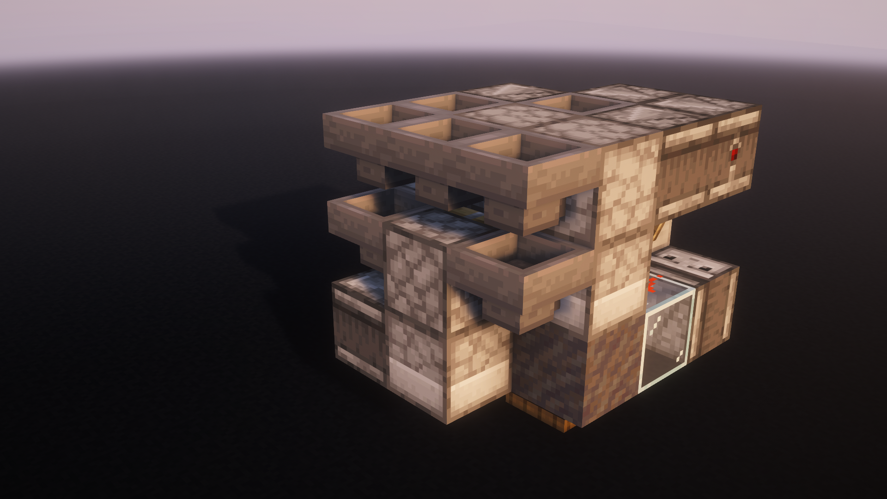

# F36: a 3×3×4 6× shulker box loader

[All projects](../README.md) · [Minecraft MCP](../../../README.md)

A single-item 6× loader that fits in 3×3×4 including piston movement. Carted modules tile every three blocks at the same height. [HaJiYue (真-哈基月)’s 3×4×4 loader (BV1qP4y1G7mz)](https://www.bilibili.com/video/BV1qP4y1G7mz/) served only as a size comparison baseline: F36 has 25% less bounding volume and is not a modification of that design.

GPT-6 Astra developed the design in Minecraft Java 26.3 through Minecraft MCP; Mak set the requirements and reviewed the prototypes. The finished machine uses vanilla mechanics.

*The standalone cartless core. The waterway and external storage are outside the 3×3×4 core.*

## Download the schematics

The schematics were exported from Minecraft Java 26.3 on November 8, 2026. All dimensions below use X × Y × Z (width × height × depth).

| Download | Dimensions | Use |
| --- | --- | --- |
| [F36-carted-array-water.litematic](schematics/F36-carted-array-water.litematic?raw=true) | 16 × 4 × 5 | Four adjacent modules with a shared waterway; one hopper minecart per module. |
| [F36-carted-single-core.litematic](schematics/F36-carted-single-core.litematic?raw=true) | 3 × 3 × 4 | One core with its hopper minecart; use this variant when tiling. Supply and storage are external. |
| [F36-cartless-single-core.litematic](schematics/F36-cartless-single-core.litematic?raw=true) | 3 × 3 × 4 | One standalone core without a minecart, for use on its own. |

[SHA-256 checksums](schematics/SHA256SUMS). [Report a problem](https://github.com/MakkCH/minecraft_mcp/issues).

The files include block states, inventories and minecarts. When pasting a carted schematic, include entities and preserve their NBT. For a survival build, follow the minecart placement in [Build and use](#build-and-use); Litematica’s block overlay covers only the blocks.

## What the design does

- 6× filling, with a pause to replace each full box.
- Three-block tiling: carted modules fit side by side at the same height and orientation.
- Single-layer waterway: the array shares a waterway, with excess input flowing downstream to an overflow collection point.
- Cartless standalone option: a single module can run without a minecart. Tiled modules use a disabled hopper minecart, with one wooden shovel in each slot, to keep incoming items from spilling during box changes.

The name F36 refers to the core’s 36-block bounding volume. Waterways, output storage and temporary scaffolding sit outside it. The schematics include one working shulker box and nine spares per module, plus the minecarts and shovels for the carted versions.

## Build and use

1. Load the appropriate schematic in Litematica. Use the cartless core on its own, or the carted variant for adjacent tiling.
2. Follow the [video’s minecart placement and startup demonstration](https://www.bilibili.com/video/BV1JBW76CEM5/). Carted builds need a precisely placed hopper minecart with collection disabled and **one wooden shovel in each of its five slots**. Keep the cart in its placed position.
3. Connect storage below the output hopper. Keep an empty working shulker box in place and refill the rear bottom dropper with spare empty boxes before they run out.
4. For the array waterway, use waterlogged top-half stone slabs, let the water settle, and feed one item type upstream. Connect the downstream end to overflow collection or disposal.

The F36 schematic files in this folder are shared under this repository’s [MIT license](../../../LICENSE). HaJiYue’s linked design is referenced for comparison only; it is not included in these downloads or covered by this license.
